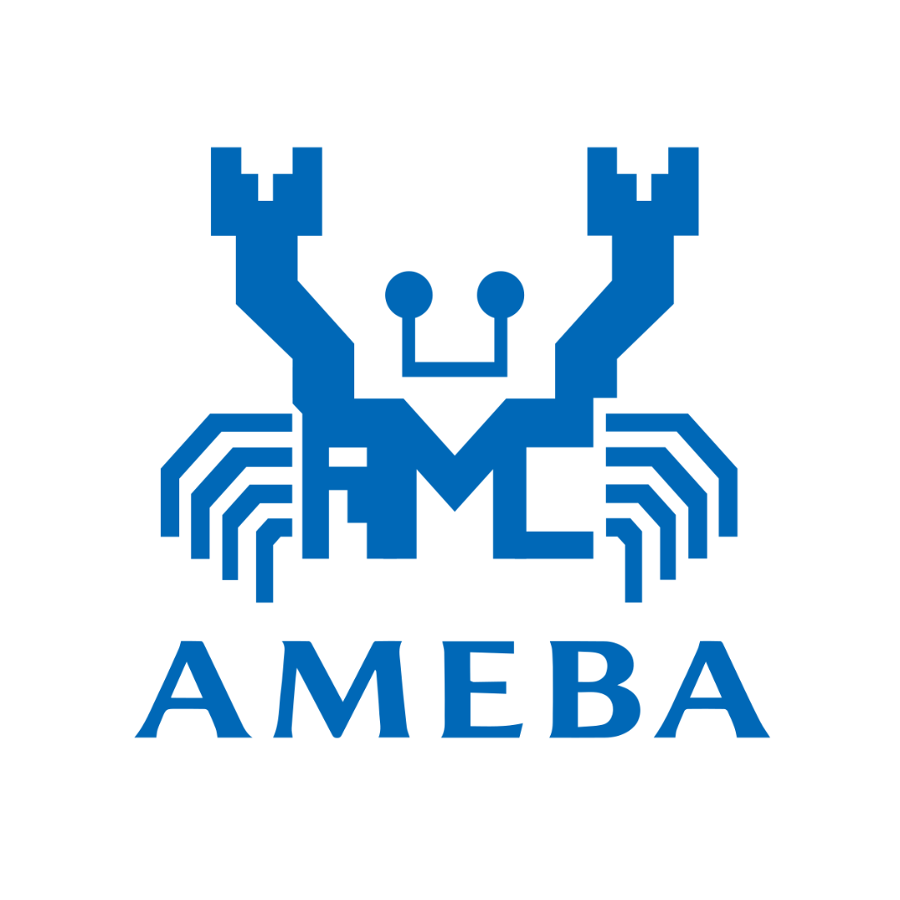

<p align="center">
  
</p>

<h1 align="center">Ameba Pro2 Education Kit</h1>

<p align="center">
  A reproducible workspace for building, flashing and streaming video from the<br>
  Realtek <b>Ameba Pro2 (RTL8735B)</b> to <b>Amazon Kinesis Video Streams</b>, with AI-assistant tooling.
</p>

---

## Overview

This repository bundles everything needed to get an Ameba Pro2 board from a clean machine to a working
video-streaming demo:

- **One-command setup** of the SDK, the AWS KVS producer library, the web viewer and the ARM toolchain.
- **Example firmware** to verify the build and flash flow before touching the cloud.
- **SDK configuration notes** for the sensor, mbedTLS and KVS credentials.
- **MCP server** that lets an AI assistant control the board over serial and inspect KVS video frames.
- **Browser viewer** for watching the KVS stream live.

## Repository Layout

| Path | Description |
|---|---|
| `bootstrap.sh` | Clones the repositories listed in `dependencies.txt`, copies the examples into the SDK and installs the toolchain |
| `dependencies.txt` | Manifest of repositories to clone (path, URL, branch or tag, submodules) |
| `hello_world/` | Minimal example that confirms build and flash work. No wiring or Wi-Fi needed |
| `sdk/README.md` | SDK configuration, build and flash instructions |
| `mcp/` | MCP server for serial control and KVS frame retrieval. See [`mcp/README.md`](mcp/README.md) |
| `index_realtek.html` | Browser viewer for the Kinesis Video Streams output |
| `assets/` | Branding assets |

Cloned at bootstrap time and git-ignored: `sdk/ameba-rtos-pro2/`, `viewer/` and `tool_chain/`.

## Prerequisites

- **Windows 11 with WSL 2 (Ubuntu).** Firmware is built in WSL and flashed from Windows, because the board's COM port belongs to Windows.
- In WSL: `git`, `curl`, `tar`, `bzip2`, `cmake` and `make`.
- An **Ameba Pro2** board connected over USB serial.
- For the streaming demo: an AWS account and a Kinesis Video Streams stream.

```bash
sudo apt install -y git curl tar bzip2 cmake make
```

## Quick Start

### 1. Bootstrap the workspace (WSL)

```bash
git clone <this-repo-url> ameba-edu-pro2
cd ameba-edu-pro2
./bootstrap.sh
```

The script is idempotent and safe to re-run. It:

1. Clones or updates each repository in `dependencies.txt`.
2. Copies the examples (currently `hello_world`) into `sdk/ameba-rtos-pro2/component/example/`. Existing copies are never overwritten.
3. Downloads and extracts the Ameba toolchain into `sdk/ameba-rtos-pro2/tools/`, then verifies the compiler.

Set `FORCE=1` to reinstall the toolchain:

```bash
FORCE=1 ./bootstrap.sh
```

When it finishes, add the toolchain to your `PATH` using the `export PATH=...` line printed at the end of the run.

### 2. Build and flash `hello_world`

Build in WSL:

```bash
cd sdk/ameba-rtos-pro2/project/realtek_amebapro2_v0_example/GCC-RELEASE
rm -rf build && mkdir build && cd build
cmake .. -G"Unix Makefiles" -DCMAKE_TOOLCHAIN_FILE=../toolchain.cmake -DEXAMPLE=hello_world
cmake --build . --target flash -j$(nproc)
```

Put the board in download mode and flash from PowerShell (replace `COM5` with your port):

```powershell
cd sdk\ameba-rtos-pro2\tools\image_tool\Pro2_PG_tool_v1.4.3
.\uartfwburn.exe -p COM5 -f ..\..\..\project\realtek_amebapro2_v0_example\GCC-RELEASE\build\flash_ntz.bin -b 2000000 -U -x 32 -r
```

Reset the board and open the serial console at **115200 baud**. You should see:

```
Hello World! count=1
Hello World! count=2
Hello World! count=3
```

See [`hello_world/readme.txt`](hello_world/readme.txt) for details.

### 3. Stream video to Amazon KVS

Configure the sensor, mbedTLS version and AWS credentials, then build with `-DEXAMPLE=kvs_producer_mmf`.
The full procedure is in [`sdk/README.md`](sdk/README.md).

> **Security:** never commit AWS keys. Use a dedicated key for the board, and a separate read-only key for the MCP server.

## AI Assistant Integration (MCP)

The [`mcp/`](mcp/README.md) server exposes the board and the cloud stream to an MCP-capable assistant such as Claude Code.

| Capability | Tools |
|---|---|
| Serial connection | `serial_list_pc_ports`, `serial_connect_board`, `serial_disconnect_board` |
| Wi-Fi | `serial_scan_wifi`, `serial_connect_wifi`, `serial_disconnect_wifi` |
| Board console | `serial_send_at_command`, `serial_set_kvs_target` |
| KVS video | `aws_download_kvs_frames`, `aws_read_kvs_frames` |

Example prompts: *"Connect to COM5"*, *"Scan for Wi-Fi networks"*, *"Set the target object to person"*, *"Download frames from the KVS stream and show me what's in them."*

Setup and registration steps are in [`mcp/README.md`](mcp/README.md).

## Viewing the Stream

Open `index_realtek.html` in a browser to watch the Kinesis Video Streams output. The page loads its styles and assets from `viewer/`, which `bootstrap.sh` clones from the AWS media-viewer sample. You will need AWS credentials with read access to the stream.

## Versions

| Component | Version |
|---|---|
| SDK | [`Ameba-AIoT/ameba-rtos-pro2`](https://github.com/Ameba-AIoT/ameba-rtos-pro2), branch `main` (last synced 2026-11-03) |
| Toolchain | `asdk-10.4.1` (newlib, Linux x86_64) |
| KVS producer | [`amazon-kinesis-video-streams-producer-embedded-c`](https://github.com/aws-samples/amazon-kinesis-video-streams-producer-embedded-c) `v1.0.1` |
| Flash tool | `Pro2_PG_tool_v1.4.3` |

To change a pinned version, edit `dependencies.txt` (or `TOOLCHAIN_URL` in `bootstrap.sh`) and re-run `./bootstrap.sh`.

## Troubleshooting

| Symptom | Fix |
|---|---|
| `bootstrap.sh` reports a missing tool | Install it with `sudo apt install -y <tool>` |
| Edits to `hello_world/` do not appear in a build | `bootstrap.sh` never overwrites an existing SDK copy. Delete `sdk/ameba-rtos-pro2/component/example/hello_world` and re-run it |
| Flash fails with "port busy" | Close Tera Term or any other program holding the COM port. Only one can use it at a time |
| Toolchain download interrupted | Re-run `./bootstrap.sh`. The download resumes from the cached partial file |

## Resources

- [Ameba AIoT on GitHub](https://github.com/Ameba-AIoT)
- [Ameba developer forum](https://forum.amebaiot.com)
- [Amazon Kinesis Video Streams documentation](https://docs.aws.amazon.com/kinesisvideostreams/)
